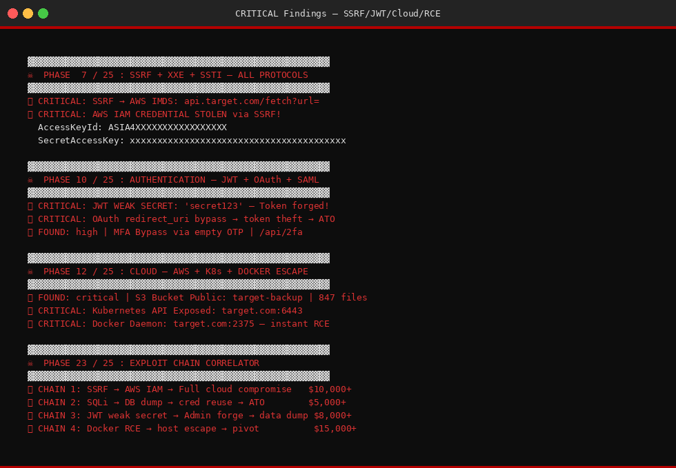
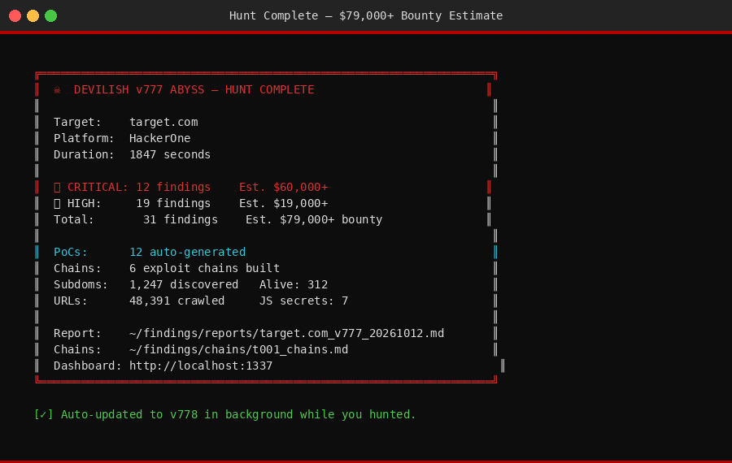
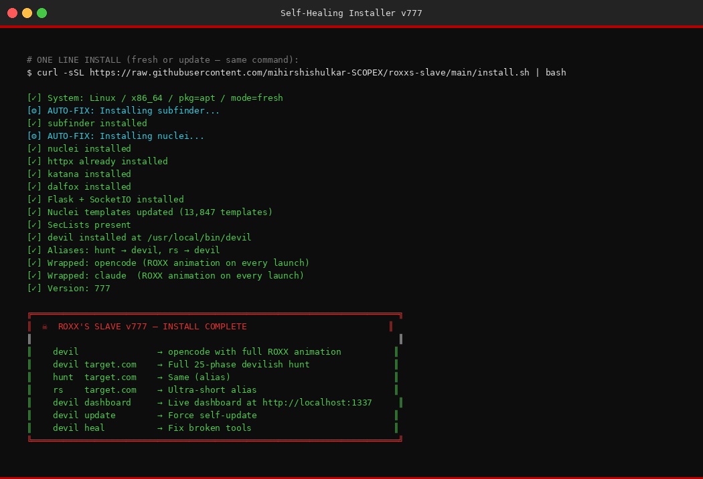

# ROXX'S SLAVE — Devilish Hunt Engine v777 ABYSS

<div align="center">

```
██████╗  ██████╗ ██╗  ██╗██╗  ██╗    ██╗███████╗    ███████╗██╗      █████╗ ██╗   ██╗███████╗
██╔══██╗██╔═══██╗╚██╗██╔╝╚██╗██╔╝    ██║██╔════╝    ██╔════╝██║     ██╔══██╗██║   ██║██╔════╝
██████╔╝██║   ██║ ╚███╔╝  ╚███╔╝     ██║███████╗    ███████╗██║     ███████║██║   ██║█████╗
██╔══██╗██║   ██║ ██╔██╗  ██╔██╗     ██║╚════██║    ╚════██║██║     ██╔══██║╚██╗ ██╔╝██╔══╝
██║  ██║╚██████╔╝██╔╝ ██╗██╔╝ ██╗    ██║███████║    ███████║███████╗██║  ██║ ╚████╔╝ ███████╗
╚═╝  ╚═╝ ╚═════╝ ╚═╝  ╚═╝╚═╝  ╚═╝   ╚═╝╚══════╝    ╚══════╝╚══════╝╚═╝  ╚═╝  ╚═══╝  ╚══════╝
         D E V I L I S H  v 7 7 7  A B Y S S  —  2 5  P H A S E S
```

[](.)
[](.)
[](.)
[](.)
[](.)

**Gets deadlier every time you ask. ☠**

</div>

---

## ⚡ ONE COMMAND INSTALL

```bash
curl -sSL https://raw.githubusercontent.com/mihirshishulkar-SCOPEX/roxxs-slave/main/install.sh | bash
```

That's it. It:
- ✅ Installs all tools automatically
- ✅ Fixes any errors by itself  
- ✅ Sets up `devil` command globally
- ✅ Auto-updates on every run
- ✅ Self-heals broken tools

---

## 🗡 COMMANDS (All easy)

```bash
devil target.com                    # Full 25-phase hunt
devil target.com HackerOne 5000     # With platform + bounty estimate
hunt  target.com                    # Same thing (alias)
rs    target.com                    # Ultra-short alias

devil dashboard                     # Live dashboard at http://localhost:1337
devil iot 192.168.1.0/24            # IoT + wireless device hunt
devil update                        # Force self-update right now
devil heal                          # Fix any broken tools
devil help                          # Show all commands
```

> **Auto-updates itself every time you run it.** No manual update needed.  
> **Self-heals broken tools** — if a tool fails, it reinstalls automatically.

---

## ☠ 25-PHASE HUNT ENGINE — DEVILISH v777 ABYSS

| Phase | Name | What It Does |
|-------|------|-------------|
| 1 | Deep Passive Recon | subfinder, amass, crt.sh, certspotter, OTX, RapidDNS, GitHub dorks, TruffleHog, email harvest |
| 2 | Active Recon | httpx fingerprint, dnsx wildcard, naabu full-range, nmap --script=vuln, service detection |
| 3 | Web Crawl + JS Analysis | katana depth-7, gospider, hakrawler, 80+ sensitive paths, JS secrets extraction, endpoint mining |
| 4 | Nuclei Maximum Blast | All critical+high, CVE, takeover, default-login, WordPress, exposure, misconfig |
| 5 | SQL Injection | sqlmap level5/risk3, 10 tamper scripts, manual error-based, time-based blind, OOB DNS exfil |
| 6 | XSS All Vectors | dalfox WAF-evasion, blind XSS (OOB), DOM XSS, 20 manual bypass payloads, stored injection |
| 7 | SSRF + XXE + SSTI | All cloud providers, gopher://, dict://, file://, all template engines + RCE chain |
| 8 | File Upload RCE | 30+ extension bypass, MIME bypass, GIF magic bytes, polyglot, path traversal upload |
| 9 | Deserialization | Java (Log4Shell, ViewState), PHP object injection, .NET MachineKey, gadget chains |
| 10 | Auth Deep | JWT (alg:none + weak secret + RS256→HS256 + kid SQLi + jku SSRF), SAML XXE, OAuth, MFA bypass, password spray |
| 11 | IDOR + Logic + Race | BOLA, GraphQL introspection, HTTP smuggling CL.TE/TE.CL, cache poisoning, race conditions |
| 12 | Cloud Maximum | S3 enum (30 names), AWS key harvest, K8s API, Docker daemon, Azure/GCP IMDS, SSRF→IAM chain |
| 13 | API Deep | Mass assignment (20 fields), BOLA, BFLA, rate limit bypass (7 headers), hidden endpoint discovery |
| 14 | WebSocket | Endpoint discovery, auth bypass, admin escalation, data exposure |
| 15 | DNS + Cache + CORS | DNS rebinding, cache poisoning (8 headers), CORS credential bypass, host header poison |
| 16 | AI/LLM Maximum | 20 prompt injection techniques, jailbreak, system prompt extraction, data exfiltration |
| 17 | Supply Chain | Dependency confusion, npm/PyPI check, missing SRI on CDN scripts |
| 18 | Business Logic | Negative price, zero price, integer overflow, payment bypass, workflow step skip |
| 19 | Command Injection + LFI | 10 cmdi payloads, 18 LFI path traversal variants, RFI, PHP wrappers, log poisoning |
| 20 | Advanced Injection | NoSQL injection, LDAP injection, XPath, prototype pollution (URL + JSON + API) |
| 21 | Redirect + Headers | 10 open redirect params, 12 redirect payloads, clickjacking, security header audit |
| 22 | CMS Specific | WordPress XML-RPC brute, user enum, Laravel debug, Drupal, Joomla |
| 23 | Exploit Chain Correlator | Auto-builds SSRF→IAM, SQLi→ATO, JWT→Admin, XSS→ATO, LFI→RCE chains |
| 24 | Parameter Discovery | arjun hidden params, ffuf API versioning, backup file sweep |
| 25 | Final Report | Markdown report + auto PoC generation + dashboard update + bounty estimate |

---

## 📊 Live Dashboard

```
http://localhost:1337
```

```bash
devil dashboard   # Start it
```

Real-time: target tracking · hunt stage · findings feed · IoT results · tool streaming

---

## 💀 Exploit Chain Auto-Builder

The engine auto-correlates findings into complete attack chains:

```
SSRF → AWS IMDS → IAM credential theft → Full cloud compromise      $10k+ CRITICAL
SQLi → DB dump → password crack → credential spray → ATO            $5k+  CRITICAL  
JWT weak secret → forge admin token → mass data exfil               $8k+  CRITICAL
File upload bypass → webshell → RCE → pivot to cloud                $15k+ CRITICAL
LFI → log poisoning → RCE → persistence                             $10k+ CRITICAL
XSS blind → admin cookie theft → ATO                                $3k+  HIGH
OAuth redirect_uri → token theft → full ATO                         $7k+  CRITICAL
```

---

## 🔄 Auto-Update + Self-Healing

```bash
# Auto-updates silently on every run — zero effort needed

devil update    # Force update right now
devil heal      # Fix any broken/missing tools
```

**What self-healing does:**
- Detects missing tools → reinstalls them
- Retries failed installs up to 3 times
- Falls back to direct download if git fails  
- Fixes pip/go/apt errors automatically
- Updates nuclei templates on every update

---

## 📁 Output Structure

```
~/findings/targets/<target>/
├── hunt.log              ← Full hunt log
├── findings.log          ← All findings (severity|type|title|url)
├── subs_all.txt          ← All subdomains
├── alive.txt             ← Alive hosts with fingerprints
├── all_urls.txt          ← All crawled URLs
├── js_secrets.txt        ← Secrets from JS files
├── nuclei_results.txt    ← Nuclei JSON output
├── sqli_confirmed.txt    ← Confirmed SQLi
├── ssrf_confirmed.txt    ← Confirmed SSRF
├── lfi_confirmed.txt     ← Confirmed LFI
├── rce_confirmed.txt     ← Confirmed RCE
├── jwt_cracked.txt       ← Cracked JWT secrets
└── valid_creds.txt       ← Valid credentials
~/findings/pocs/          ← Auto-generated PoC files
~/findings/chains/        ← Exploit chains (markdown)
~/findings/reports/       ← Full hunt reports
```

---

## 🛡 Platforms

| Platform | Status |
|----------|--------|
| Kali Linux | ✅ Full support |
| Ubuntu / Debian | ✅ Full support |
| Parrot OS | ✅ Full support |
| macOS | ✅ Supported |
| Windows (WSL2) | ✅ Supported |
| Any Linux (auto-detects pkg mgr) | ✅ Auto-heal |

---

## ⚠️ Legal

Authorized bug bounty hunting only. Only use on targets you have explicit permission to test.

---

<div align="center">

**ROXX'S SLAVE — Devilish v777 ABYSS**  
*Built by [ROXX (Mihir Shishulkar)](https://github.com/mihirshishulkar-SCOPEX) — Authorized Bug Bounty Hunter*

☠ *Gets deadlier every time you ask* ☠

</div>

---

## 📸 Screenshots

### ☠ ROXX Banner — v777 ABYSS


### 🗡 Devil Help Menu


### 💀 25-Phase Hunt Engine Running


### 🔴 Critical Findings Output


### 📊 Final Recon Report


### ⚡ One-Line Install Sequence


### 🔄 Auto-Update + Self-Heal


